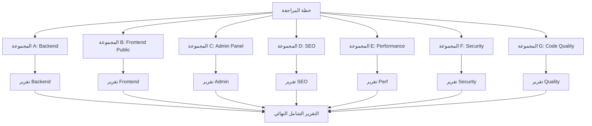
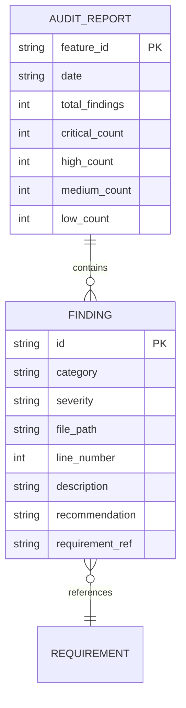

# Implementation Plan: Full Site Review & Audit

**Feature**: `009-full-site-review-audit`  
**Created**: 2026-10-31  
**Stack**: Laravel 11 + Inertia.js + React + Tailwind CSS  

---

## Architecture Overview



---

## Phases

### Phase 1: Security & Auth (الأمان والمصادقة)

**الأولوية القصوى — يجب إنجازه أولاً**

تغطية:
- فحص كل Admin routes في `routes/web.php`
- فحص Middleware stack
- فحص file upload validation
- فحص rate limiting على: login, OTP, contact, AI chat
- فحص CSRF على كل forms
- فحص SQL injection في كل Controllers
- فحص XSS في كل React pages
- فحص `.env` exposure

**الملفات المستهدفة**:
```
routes/web.php
app/Http/Middleware/
app/Http/Controllers/Auth/LoginController.php
app/Http/Controllers/Public/AiAssistantController.php
app/Http/Controllers/Public/MessageController.php
app/Domain/*/Actions/*
resources/js/Pages/Shared/
```

**Tools**:
```bash
grep -r "middleware" routes/web.php
grep -r "RateLimiter\|throttle" app/
grep -r "dangerouslySetInnerHTML\|innerHTML" resources/js/
```

---

### Phase 2: Database & Performance (قاعدة البيانات والأداء)

**المستوى الثاني — تأثير مباشر على تجربة المستخدم**

تغطية:
- فحص 67 migration لـ missing indexes
- فحص N+1 في 34 controller
- فحص caching strategy
- فحص Inertia props size (لا بيانات زائدة)
- فحص frontend bundle size
- فحص Core Web Vitals readiness

**الملفات المستهدفة**:
```
database/migrations/ (67 files)
app/Http/Controllers/**/*.php (34 files)
resources/js/Pages/**/*.jsx (46 files)
vite.config.js
```

**Tools**:
```bash
php artisan migrate:status
php artisan db:show
grep -r "->all()" app/Http/Controllers/
grep -r "->with(" app/Http/Controllers/
npm run build 2>&1 | grep -E "dist|kB|MB"
```

---

### Phase 3: SEO Audit (تهيئة محركات البحث)

**المستوى الثالث — تأثير على الوصول العضوي**

تغطية:
- فحص `<Head>` component في كل صفحة عامة
- فحص Open Graph tags
- فحص JSON-LD structured data
- فحص Sitemap (6 endpoints)
- فحص robots.txt
- فحص canonical URLs
- فحص Arabic SEO (lang, dir attributes)

**الملفات المستهدفة**:
```
resources/js/Pages/Public/**/*.jsx
resources/js/Components/UI/SeoHead.jsx
app/Http/Controllers/Public/SitemapController.php
public/robots.txt
```

**Tools**:
```bash
grep -r "Head\|SeoHead" resources/js/Pages/ --include="*.jsx" -l
grep -r "application/ld+json" resources/js/
curl http://localhost/robots.txt
curl http://localhost/sitemap.xml
```

---

### Phase 4: Design Audit (مراجعة التصميم)

**المستوى الرابع — اتساق الهوية البصرية**

تغطية:
- فحص استخدام ألوان DESIGN.md فقط
- فحص Cairo font
- فحص RTL layout
- فحص Button/InputField components
- فحص mobile responsiveness
- فحص empty/loading/error states

**الملفات المستهدفة**:
```
resources/js/Pages/Public/**/*.jsx
resources/js/Components/UI/Button.jsx
resources/js/Components/UI/InputField.jsx
resources/js/Components/Layout/Header.jsx
resources/js/Components/Layout/Footer.jsx
DESIGN.md
```

**Tools**:
```bash
grep -r "text-red-\|bg-red-" resources/js/ --include="*.jsx"
grep -r "ml-\|pl-\|left-" resources/js/ --include="*.jsx"
grep -r "font-sans\|font-mono" resources/js/ --include="*.jsx"
```

---

### Phase 5: Admin Panel Review (مراجعة لوحة الإدارة)

**المستوى الخامس — كفاءة العمليات الإدارية**

تغطية كل 10 sections:
1. Dashboard — stats, links, loading
2. Units CRUD — search, filter, image management, actions
3. Projects CRUD — autofill, approval, extension
4. Users — role change, cascade check, password
5. Notifications — unread, mark read, dismiss, clear
6. Messages/Leads — mark replied, export, WhatsApp
7. SEO Pages — edit meta, character count
8. Settings — save, reflect on site
9. Points — allocate, deduct, reset, ledger
10. AI Knowledge — CRUD, toggle, cache clear

**الملفات المستهدفة**:
```
resources/js/Pages/Admin/**/*.jsx
app/Http/Controllers/Admin/**/*.php
```

---

### Phase 6: Code Quality (جودة وتنظيم الكود)

**المستوى الأخير — صيانة طويلة المدى**

تغطية:
- فحص `dd()`, `dump()`, `console.log` في production
- فحص TODO/FIXME blocking comments
- فحص Controllers > 200 سطر
- فحص test coverage على critical paths
- فحص orphaned controllers/models
- فحص hardcoded strings (يجب في lang files)

**Tools**:
```bash
grep -r "dd(\|dump(" app/ --include="*.php"
grep -r "console\." resources/js/ --include="*.jsx"
grep -r "TODO\|FIXME" app/ resources/js/ --include="*.php" --include="*.jsx"
./vendor/bin/pest --coverage
```

---

## Data Model (Audit Findings Structure)



---

## Security Considerations

- المراجعة **read-only** فقط — لا تعديل كود
- لا يُنفَّذ كود مجهول المصدر
- نتائج الأمان تُحفَظ محلياً فقط (لا ترفع للـ cloud)
- ثغرات Critical تُبلَّغ للمطوّر فوراً قبل إنهاء التقرير

---

## Performance Strategy

- فحص كل group بشكل مستقل (موازي حيث ممكن)
- استخدام `grep`, `php artisan`, `npm run build` للفحص الآلي
- الفحص البصري للـ UI يكون آخراً (أبطأ)
- التقرير يُنتَج incrementally (section by section)

---

## Error Handling

- إذا فشل أمر `php artisan`: توثيق الخطأ وإكمال باقي الفحوصات
- إذا كان ملف غير موجود: تسجيل "file missing" كـ finding
- إذا تعذّر بناء الـ frontend: توثيق وإكمال الفحص اليدوي

---

## Output Format

التقرير النهائي: `FULL_AUDIT_REPORT.md` في `.specify/specs/009-full-site-review-audit/`

```markdown
# تقرير المراجعة الشاملة — Family Home
## ملخص تنفيذي (جدول إجمالي)
## Critical Findings 🔴
## High Priority Findings 🟠  
## Medium Priority Findings 🟡
## Low Priority Findings 🟢
## Passing Checks ✅
## Recommended Action Plan
```

