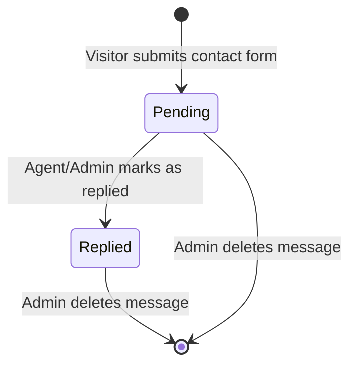

# Data Model: Full Engineering Audit & Remediation

## Overview

This document specifies the database models, relations, field semantics, validation rules, and lifecycle states affected by the Full Engineering Audit & Remediation plan for the **Family Home Laravel Web** application.

---

## 1. Entities & Schema Definitions

### 1.1 Message Entity (`messages` table)

Client inquiry submitted via property contact forms or general platform contact.

```
       +---------------------------------------------+
       |                  messages                   |
       +---------------------------------------------+
       | id: bigint unsigned (PK, AUTO_INCREMENT)    |
       | unit_id: bigint unsigned (FK -> units.id) ? |
       | agent_id: bigint unsigned (FK -> users.id) ?|
       | client_name: varchar(255)                   |
       | client_phone: varchar(20) ?                 |
       | client_email: varchar(255) ?                |
       | content: text                               |
       | status: varchar(10) ['pending', 'replied']  |
       | replied_at: timestamp ?                     |
       | created_at: timestamp                       |
       | updated_at: timestamp                       |
       +---------------------------------------------+
                 |                         |
                 v                         v
         +---------------+         +---------------+
         |     units     |         |     users     |
         +---------------+         +---------------+
```

#### Fields & Attributes

| Column | Type | Nullable | Default | Description & Constraints |
|--------|------|----------|---------|---------------------------|
| `id` | `bigint unsigned` | No | Auto | Primary Key |
| `unit_id` | `bigint unsigned` | Yes | `NULL` | Property ID if inquiry originated from a unit page. `NULL` for general platform contact. Foreign key cascades on delete. |
| `agent_id` | `bigint unsigned` | Yes | `NULL` | Assigned agent (user ID) responsible for handling the inquiry. Fallbacks to primary admin if unit has no owner or is general. |
| `client_name` | `varchar(255)` | No | — | Name of client. Sanitized plain text, stripped of tags. |
| `client_phone` | `varchar(20)` | Yes | `NULL` | Client phone/WhatsApp number. |
| `client_email` | `varchar(255)` | Yes | `NULL` | Client email address (validated format). |
| `content` | `text` | No | — | Message body. Sanitized plain text. |
| `status` | `varchar(10)` | No | `'pending'` | Current inquiry lifecycle state: `'pending'` or `'replied'`. |
| `replied_at` | `timestamp` | Yes | `NULL` | Timestamp when agent marked message as replied. |
| `created_at` | `timestamp` | No | Current | Submission timestamp. |
| `updated_at` | `timestamp` | No | Current | Last modification timestamp. |

#### Database Indexes

| Index Name | Columns | Purpose |
|------------|---------|---------|
| `messages_unit_id_index` | `(unit_id)` | Fast lookup of messages linked to a property listing. |
| `messages_agent_id_index` | `(agent_id)` | Fast filtering for agent messages inbox. |
| `messages_status_index` | `(status)` | Fast filtering by `'pending'` / `'replied'`. |
| `messages_created_at_id_index` | `(created_at, id)` | Efficient sorting by reverse chronological order with pagination. |

#### State Transitions



---

### 1.2 Notification Entity (`notifications` table)

Laravel's standard polymorphic database notification table.

```
       +-----------------------------------------------+
       |                 notifications                 |
       +-----------------------------------------------+
       | id: char(36) (PK, UUID)                       |
       | type: varchar(255)                            |
       | notifiable_type: varchar(255)                 |
       | notifiable_id: bigint unsigned                |
       | data: json / text                             |
       | read_at: timestamp ?                          |
       | created_at: timestamp                         |
       | updated_at: timestamp                         |
       +-----------------------------------------------+
```

#### JSON Payload Structure for `NewMessageNotification`

```json
{
  "type": "new_message",
  "title": "رسالة جديدة من عميل",
  "title_en": "New Message from Client",
  "message_id": 142,
  "unit_id": 45,
  "unit_name": "شقة للبيع في التجمع الخامس",
  "client_name": "أحمد محمود",
  "client_phone": "01001234567",
  "content": "هل الوحدة متاحة للمعاينة؟",
  "message": "رسالة جديدة من أحمد محمود بخصوص: شقة للبيع في التجمع الخامس"
}
```

#### Database-Level JSON Querying Rules

To prevent PHP memory exhaustion when clearing or marking notifications:
- Target unit notifications: `where('data->unit_id', $unitId)`
- Target project notifications: `where('data->project_id', $projectId)`
- Target message notifications: `where('data->message_id', $messageId)`

---

## 2. Validation Rules Matrix

### 2.1 Public Contact Message (`StoreMessageRequest`)

| Field | Rules | Sanitization |
|-------|-------|--------------|
| `client_name` | `required`, `string`, `min:2`, `max:100` | `Sanitizer::text()` |
| `client_phone` | `required_without:client_email`, `nullable`, `string`, `max:20` | `Sanitizer::text()` |
| `client_email` | `required_without:client_phone`, `nullable`, `email:rfc,dns`, `max:255` | `Sanitizer::text()` |
| `content` | `required`, `string`, `min:5`, `max:2000` | `Sanitizer::text()` |
| `unit_id` | `nullable`, `integer`, `exists:units,id` | Cast to integer |

### 2.2 CSV Export Row Serialization & Escaping

Every exported row applies cell-level CSV injection protection:

```php
function sanitizeCsvCell(?string $value): string {
    if ($value === null || $value === '') {
        return '';
    }
    // Neutralize spreadsheet executable formulas
    if (in_array($value[0], ['=', '+', '-', '@', "\t", "\r"], true)) {
        return "'" . $value;
    }
    return $value;
}
```

---

## 3. Cache Keys & Invalidation Matrix

| Cache Key Pattern | TTL | Data Stored | Trigger Event | Invalidation Logic |
|-------------------|-----|-------------|---------------|-------------------|
| `user_{id}_unread_count` | 30s | `int` count of unread notifications | Notification created, read, or deleted | `Cache::forget("user_{$id}_unread_count")` |
| `user_{id}_recent_notifications` | 30s | Array of top 5 notifications | Notification created, read, or deleted | `Cache::forget("user_{$id}_recent_notifications")` |
| `user_{id}_notifications_page_{p}` | 60s | Paginated notification collection | Page visited | Cleared via `NotificationService::clearUserCache()` |
| `seo_pages_cache` | 3600s | PageSeo Eloquent models collection | PageSeo model updated/created | `Cache::forget('seo_pages_cache')` |
| `unit_{id}_primary_thumb` | 300s | Primary thumbnail URL string | Unit image updated/deleted | `Cache::forget("unit_{$id}_primary_thumb")` |
| `unit_{id}_agent_name` | 300s | Agent uploader name string | Unit or owner updated | `Cache::forget("unit_{$id}_agent_name")` |
| `listing_cache_version_v2` | Forever | Integer version counter | Unit/Project saved or deleted | Atomic `Cache::increment()` with mutex lock |
