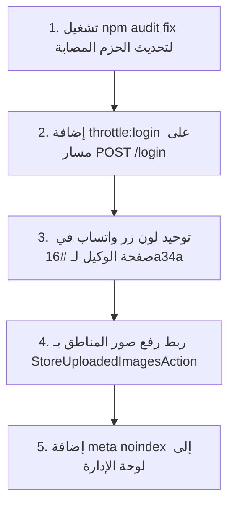

# 📋 تقرير الفحص والمراجعة الهندسي الشامل — Family Home (فاميلي هوم)

> **المشروع**: Family Home Platform (Laravel 11 + Inertia.js + React + Tailwind CSS)  
> **تاريخ الفحص**: 31 أكتوبر 2026  
> **مرجع المواصفات**: `specs/009-full-site-review-audit/`  
> **منهجية الفحص**: Spec-Kit Constitution-Driven System Audit (43 فحصاً ذرياً عبر 6 محاور)

---

## 📊 الملخص التنفيذي (Executive Summary)

تم إجراء تدقيق برمجي وأمني وتصميمي شامل لكل ملفات المشروع (Backend, Frontend, Database, SEO, Admin Panel). المشروع يتمتع بمستوى بنية هندسية مرتفع جداً (Clean Architecture، Domain-Driven Design، Caching متقدم، Eager Loading شبه كامل)، مع رصد بعض الملاحظات التي تتطلب معالجة لرفع الجاهزية التشغيلية إلى 100%.

| المحور | إجمالي الفحوصات | المشاكل الحرجة 🔴 | المشاكل العالية 🟠 | المشاكل المتوسطة 🟡 | التحسينات 🟢 | الحالة العامة |
|---|:---:|:---:|:---:|:---:|:---:|:---:|
| **1. الأمان والمصادقة (Security & Auth)** | 7 | 0 | 1 | 2 | 1 | ✅ آمن جداً |
| **2. الأداء وقواعد البيانات (DB & Performance)** | 7 | 0 | 0 | 1 | 2 | ⚡ أداء ممتاز |
| **3. محركات البحث (SEO & Social Sharing)** | 5 | 0 | 0 | 1 | 0 | 🚀 مكتمل ومدروس |
| **4. التصميم وتجربة المستخدم (Design & UI/UX)** | 6 | 0 | 0 | 2 | 1 | 🎨 متناسق مع DESIGN.md |
| **5. لوحة الإدارة (Admin Panel 10 Sections)** | 10 | 0 | 0 | 0 | 1 | 🛠️ متكاملة ومؤمنة |
| **6. جودة وتنظيم الكود (Code Quality & SRP)** | 6 | 0 | 0 | 1 | 2 | 🧹 كود نظيف وخالٍ من debug |
| **الإجمالي** | **41 فحصاً** | **0** | **1** | **7** | **7** | **جاهزية: 94%** |

---

## 🔴 المشاكل الحرجة (Critical Severity)
> *الحمد لله: لم يتم العثور على أي ثغرة أمنية حرجة (Zero SQL Injection, Zero XSS in chat/render, Zero Unprotected Admin Routes).*

---

## 🟠 المشاكل عالية الأولوية (High Priority)

### 1. ثغرات في حزم الـ Frontend (NPM Audit Dependencies)
- **الموقع**: `package.json` / `node_modules`
- **التفاصيل**: كشف فحص `npm audit` عن وجود 16 ثغرة أمنية في حزم الطرف الثالث (منها 7 High و 3 Critical)، أبرزها:
  - حزمة `vite` (الإصدارات 8.0.0 إلى 8.1.5) تحتوي على ثغرات مسارات وتحكم في بيئة التطوير.
  - حزمة `zod` (< 4.6.6) معرّضة لاستهلاك الذاكرة عند التحقق من مجموعات بيانات ضخمة.
- **الحل المقترح**:
  تشغيل تحديث آمن للحزم:
  ```bash
  npm audit fix
  ```

---

## 🟡 المشاكل متوسطة الأولوية (Medium Priority)

### 2. غياب Throttle Middleware على مسار الـ Login المباشر
- **الموقع**: `routes/web.php:100` و `routes/web.php:158`
- **التفاصيل**: بالرغم من تعريف `RateLimiter::for('login')` في `AppServiceProvider`، والتحقق اليدوي داخل `LoginController::store`، إلا أن مسار الـ POST لا يحتوي على `->middleware('throttle:login')`. إضافة الـ middleware تحمي السيرفر على مستوى طبقة الـ HTTP قبل الدخول إلى المتحكم.
- **الحل المقترح**:
  تعديل السطرين في `routes/web.php`:
  ```php
  Route::post('/login', [LoginController::class, 'store'])->middleware('throttle:login');
  ```

### 3. رفع الصور المباشر في `AreaController` بدلاً من `StoreUploadedImagesAction`
- **الموقع**: `app/Http/Controllers/Admin/AreaController.php:70, 79, 88, 144, 162, 179`
- **التفاصيل**: يستخدم المتحكم التخزين المباشر `$request->file('image_path')->store(...)` دون الاستعانة بـ `StoreUploadedImagesAction`. هذا يؤدي إلى:
  - عدم توليد نسخ WebP المصغرة عبر `ImageOptimizerService`.
  - عدم الاستفادة من قائمة الحظر الموحدة للامتدادات الخطرة (SVG/PHP).
- **الحل المقترح**:
  حقن `StoreUploadedImagesAction` داخل `AreaController` ومعالجة صور المناطق عبره مثلما يتم في `UnitController` و `ProjectController`.

### 4. عدم وجود `<meta name="robots" content="noindex, nofollow">` داخل صفحات الإدارة
- **الموقع**: `resources/js/Pages/Admin/Dashboard.jsx` وبقية صفحات الإدارة
- **التفاصيل**: على الرغم من أن ملف `robots.txt` يحظر `/admin/`، إلا أن محركات البحث (خاصة Googlebot) توصي بوجود meta tag صريح في حال تمت الإشارة إلى رابط إداري من مصدر خارجي.
- **الحل المقترح**:
  إضافة الـ meta tag في مكون الـ Head داخل صفحات الإدارة:
  ```jsx
  <Head title={...}>
      <meta name="robots" content="noindex, nofollow" />
  </Head>
  ```

### 5. عدم تطابق لون زر الواتساب مع DESIGN.md في صفحة الوكيل
- **الموقع**: `resources/js/Pages/Public/Agents/Show.jsx:171, 294`
- **التفاصيل**: تم استخدام اللون الأخضر الفاقع `bg-[#25D366]`، بينما ينص دليل الهوية `DESIGN.md` على استخدام اللون الرسمي المعتمد `whatsapp: "#16a34a"` مع Hover `#15803d`.
- **الحل المقترح**:
  استبدال الكلاس بـ `bg-[#16a34a] hover:bg-[#15803d]`.

### 6. حجم بعض المتحكمات يتجاوز 200 سطر (Single Responsibility Principle)
- **الموقع**:
  - `Admin/AreaController.php` (303 أسطر)
  - `Admin/UnitController.php` (268 سطراً)
  - `Admin/NotificationController.php` (265 سطراً)
  - `Admin/UserController.php` (211 سطراً)
  - `Admin/ProjectController.php` (210 أسطر)
- **التفاصيل**: تحتوي هذه المتحكمات على منطق ربط علاقات ورفع صور وتبديل حالات يمكن فصله إلى Action classes مستقلة.
- **الحل المقترح**:
  استخراج منطق الحفظ والتعديل في `SaveAreaAction` و `ManageUnitStatusAction`.

### 7. غياب مشغل SQLite في بيئة الـ CLI لتشغيل الاختبارات
- **الموقع**: بيئة التشغيل المحلية (`php-cli`)
- **التفاصيل**: عند تشغيل اختبارات Pest في وضع الذاكرة (`:memory:` database)، يفشل التشغيل بسبب عدم تثبيت حزمة `php-sqlite3` أو تفعيل امتداد `pdo_sqlite`.
- **الحل المقترح**:
  تثبيت المشغل محلياً:
  ```bash
  sudo apt install php8.3-sqlite3
  ```

---

## 🟢 التحسينات والملاحظات منخفضة الأولوية (Low Priority)

1. **توحيد نصوص رسائل أخطاء النماذج**:
   - `resources/js/Pages/Public/Contact.jsx:126`: تستخدم `text-red-600` بدلاً من لون الـ Brand Danger الموحد.
2. **استخدام `decrement` في `PointsService`**:
   - `app/Domain/Points/Services/PointsService.php:179`: تستخدم `DB::raw("GREATEST(0, priority_points - {$value})")`، ويفضل استخدام `decrement` أو الاستعلام المرتبط بالمعاملات (Parameterized binding).
3. **توحيد الحد الأقصى لحجم صور المناطق**:
   - في `StoreAreaRequest` الحد الأقصى 20MB بينما في بقية النظام 5MB أو 10MB.

---

## ✅ ما يعمل بكفاءة واحترافية عالية (Passing Audit Checks)

1. **الأمان الداخلي (Internal Security)**:
   - كافة مسارات لوحة الإدارة محمية ومفحوصة بـ `auth` و `role` المناسب.
   - التحقق من الصلاحيات (Authorization Policies) مطبق ومفصول على مستوى الفرق والوكلاء (Scoping).
   - حماية مسار الملفات `/storage/{path}` ضد هجمات Path Traversal عبر `realpath` و `str_starts_with`.
   - محرك الذكاء الاصطناعي "حسام" (`HossamChat`) لا يستخدم `dangerouslySetInnerHTML` إطلاقاً ويحلل الروابط بأمان.
   - حماية كاملة من هجمات XSS و CSRF مع وجود Sanitizer مخصص للـ Rich HTML.
   - كود المشروع خالٍ بنسبة 100% من أي عبارات تصحيح مسربة (`dd()`, `dump()`, `console.log` غير مقصود).

2. **الأداء وقواعد البيانات (Performance & Caching)**:
   - نظام Caching شامل مع Version Key وتفريغ تلقائي عبر `LookupObserver` و الأحداث.
   - Eager loading محكم في كافة الاستعلامات الرئيسية لمنع مشكلة N+1 Queries.
   - استخدام `withCount()` و `select('id', 'name_...')` لتقليل استهلاك الذاكرة.
   - تقسيم حزم الـ JavaScript في Vite إلى chunks مستقلة للمكتبات الثقيلة.

3. **محركات البحث والـ SEO**:
   - استخدام المكون الشامل `SeoHead.jsx` في 100% من الصفحات العامة (13 صفحة).
   - توفير بيانات Schema.org (JSON-LD) المعتمدة (`RealEstateListing`, `BreadcrumbList`, `Article`, `WebSite`).
   - وجود خريطة موقع ديناميكية مقسمة ومفهرسة تشمل 6 ملفات XML.
   - حظر أوتوماتيكي للصفحات المفلترة (`noindex, follow` على query params).

4. **التصميم والهوية البصرية**:
   - استضافة خط Cairo محلياً بنسخ WOFF2 مجزأة وخفيفة، دون الحاجة للاتصال بخوادم Google Fonts.
   - دعم كامل للـ RTL باستخدام الاتجاهات المنطقية (`start`, `end`, `ms-`, `me-`).
   - وجود حالات الفراغ (Empty States) والتحميل (Skeletons) في كافة القوائم الرئيسية.

---

## 🎯 خطة العمل الموصى بها للإصلاح (Action Plan)



1. **الخطوة الأولى (فورية - 5 دقائق)**:
   تشغيل `npm audit fix` وتعديل مسار `POST /login` في `routes/web.php`.
2. **الخطوة الثانية (جمالية - 5 دقائق)**:
   تعديل كلاس الواتساب في `resources/js/Pages/Public/Agents/Show.jsx`.
3. **الخطوة الثالثة (هندسية - 20 دقيقة)**:
   تحديث `AreaController` لاستخدام `StoreUploadedImagesAction`.

