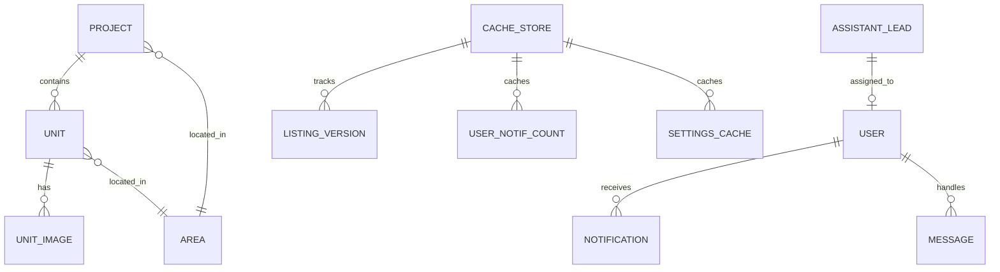
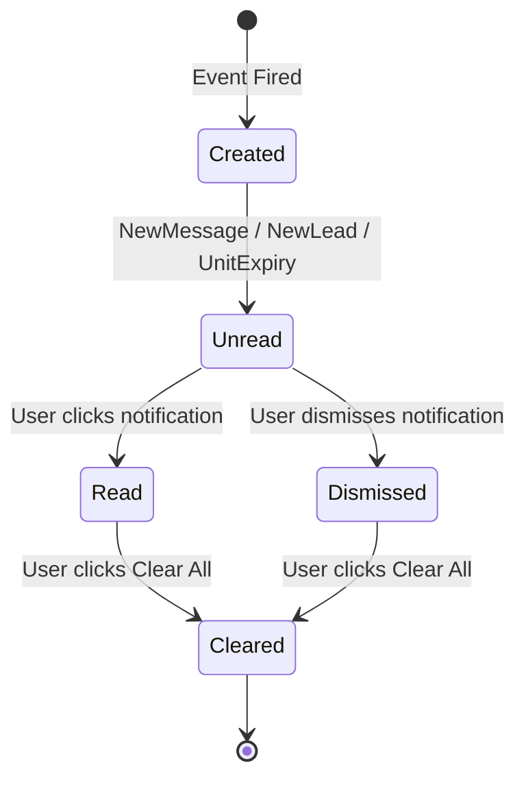

# Data Model & Cache Architecture: Remediation, Caching & Notifications

**Feature**: `010-remediation-caching-notifications`

---

## 1. Entities & Cache Invalidation Map

### Cache Key Definitions

| Entity | Cache Key Pattern | TTL | Invalidation Trigger | Action / Handler |
|---|---|---|---|---|
| **Listings Version** | `listing_cache_version` | Indefinite | أي إنشاء/تعديل/حذف في Unit أو Project | `Cache::increment('listing_cache_version')` |
| **Home Page Data** | `home_page_data_u{page}_p{page}_v{ver}` | 300s | زيادة `listing_cache_version` | تلقائي بناءً على رقم الإصدار |
| **Lookup Data** | `areas_lookup`, `unit_types_lookup` | 86400s | تعديل في Area أو UnitType | `LookupObserver::saved/deleted` |
| **Site Settings** | `settings_all` | 86400s | حفظ الإعدادات في لوحة الإدارة | `Setting::saved` / `SettingsService::save` |
| **SEO Pages** | `seo_pages_cache` | 86400s | تعديل صفحة SEO في الإدارة | `PageSeo::saved` / `PageSeoController` |
| **User Unread Notifs**| `user_{id}_unread_count` | 300s | إنشاء إشعار جديد أو قراءة/مسح إشعار | `NotificationService::invalidateCache` |
| **User Recent Notifs**| `user_{id}_recent_notifications_5` | 300s | تغيير في قائمة الإشعارات | `NotificationService::invalidateCache` |

---

## 2. Notification Model Lifecycle & Triggers

### Event Triggers & Types
1. `NewMessageNotification`: عند إرسال عميل رسالة من صفحة اتصل بنا أو صفحة العقار.
2. `NewAssistantLeadNotification`: عند التقاط رقم هاتف من شات المساعد الذكي "حسام".
3. `UnitPendingApprovalNotification`: عند إنشاء وكيل لعقار جديد يحتاج مراجعة المشرف.
4. `UnitExpiryWarningNotification`: إشعار تلقائي قبل انتهاء صلاحية عرض العقار.
5. `UnitApprovedNotification`: عند اعتماد عقار الوكيل من قبل الإدارة.

